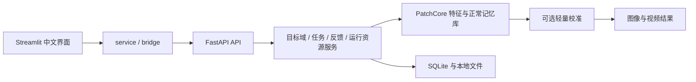

# AdaptiveAOI-Defect-Detection

AdaptiveAOI 是一个面向工业表面图像的缺陷检测系统。系统以正常样本的局部特征记忆库为基础，提供可选的缺陷引导轻量校准，以及目标域构建、单图检测、批量检测、本地视频文件检测和人工反馈工作流。

项目采用 **Streamlit + FastAPI + PyTorch**，界面以中文为主。源码包含完整的算法与应用模块；骨干权重、用户数据和运行记录独立配置。

## 主要功能

- **目标域适配**：从本地正常图像构建记忆库，可增加缺陷校准样本；支持从视频抽帧、过滤与采样。
- **图像检测**：显示图像异常分数、阈值、判定、热力图、二值掩码和叠加图。
- **批量检测**：批量任务、进度查询、检测明细和结果导出。
- **视频文件检测**：逐帧推理、抽帧步长、关键帧、帧级记录和可视化视频；支持任务暂停与取消。
- **反馈优化**：记录并审核人工纠错样本，生成候选资源版本，再由操作者应用。
- **资源管理**：管理记忆库、配置和运行方案，保留版本绑定、回滚、删除保护及测试数据隔离。
- **统计分析**：查询检测历史、任务状态、异常分布和反馈记录。

视频输入为 `.mp4`、`.avi`、`.mov`、`.mkv` 等本地文件，具体编解码支持取决于 OpenCV 运行环境。当前没有摄像头、RTSP 或产线 PLC 接口，也不承诺实时帧率。

## 技术架构



前端通过 HTTP 调用后端。后端管理任务、资源版本、检测上下文和运行状态；算法层完成图像预处理、特征提取、近邻检索、阈值判断和结果可视化。SQLite 与 JSON 保存本地运行状态，任务输出保存在本机文件系统。

## 项目结构

```text
.
├── app/                      # Streamlit 入口、页面与交互组件
│   ├── 系统总览.py
│   └── pages/
├── backend/                  # FastAPI、数据存储、任务与资源生命周期
├── bridge/                   # API 客户端、配置和路径解析
├── service/                  # 前端业务调用封装
├── core/                     # 特征、记忆库、采样、阈值和后处理
├── methods/
│   ├── patchcore/            # 正常记忆检测、目标域构建与推理
│   ├── lightweight_calibration/
│   ├── defect_calibration/   # 缺陷方向校准兼容实现
│   └── adaptive_dual_memory/ # 双记忆兼容实现
├── datasets/                 # MVTec AD、VisA、DAGM 数据适配
├── video/                    # 视频读取、逐帧推理与输出
├── configs/                  # 算法与系统 YAML 配置
├── artifacts/models/backbones/manifest.json
├── scripts/                  # 安装、启动、数据与推理工具
├── launchers/                # Windows 启停与后端守护
├── examples/                 # 可重复生成的合成输入示例
├── tests/                    # 算法、API、交互和生命周期测试
├── docs/                     # 环境与外部资源说明
├── requirements.txt
├── .env.example
├── start.bat
└── stop.bat
```

`outputs/`、`artifacts/memory_banks/`、`configs/profiles/` 等运行目录会按需生成，已由 `.gitignore` 排除。

## 环境要求与安装

已验证的运行环境为 Windows 64 位、Python **3.10.20**、PyTorch **2.6.0** 和 torchvision **0.21.0**。建议使用独立的 Python 3.10 环境。CPU 可运行，CUDA 为可选加速；Linux/macOS 和其他 Python 版本需要另外验证，Windows 文件选择器和启动脚本只适用于 Windows。

在项目根目录执行：

```powershell
conda create -n adaptive_aoi python=3.10 -y
conda activate adaptive_aoi
python -m pip install --index-url https://pypi.org/simple -r requirements.txt
python -m pip install --index-url https://pypi.org/simple -r requirements-test.txt
```

需要 CUDA 12.4 对应的 PyTorch 时，可先安装匹配的轮子，再安装项目依赖：

```powershell
python -m pip install torch==2.6.0 torchvision==0.21.0 --index-url https://download.pytorch.org/whl/cu124
python -m pip install --index-url https://pypi.org/simple -r requirements.txt
python -c "import torch; print(torch.__version__, torch.cuda.is_available())"
```

CPU FAISS 为可选依赖：`python -m pip install -r requirements-faiss.txt`。没有 FAISS 时可使用 `sklearn` 检索；Windows 的 `faiss-cpu` 不提供 GPU FAISS，GPU 检索可使用 `torch_gpu_flat`。具体回退情况记录在运行元数据中。

更完整的安装和缓存目录设置见 [环境说明](docs/environment_setup.md)。

## 配置骨干权重

算法使用 torchvision 的 `wide_resnet50_2` 或 `resnet50`，默认配置使用前者的 `layer2` 特征。需要原始完整的 ImageNet-1K V2 权重：

| 骨干 | 文件名 | 文件大小 |
|---|---|---:|
| wide_resnet50_2 | `wide_resnet50_2-9ba9bcbe.pth` | 275,905,729 字节 |
| resnet50 | `resnet50-11ad3fa6.pth` | 102,540,417 字节 |

使用显式目标目录下载默认骨干：

```powershell
python scripts/download_backbones.py --destination E:/codex/download/AdaptiveAOI/backbones
$env:ADAPTIVEAOI_BACKBONE_ROOT = 'E:/codex/download/AdaptiveAOI/backbones'
```

需要两个骨干时增加 `--backbones wide_resnet50_2 resnet50`。也可自行下载后按同名文件放入 `artifacts/models/backbones/`，保留该目录中的 `manifest.json`。加载器沿用资源清单中的大小和完整性校验，缺失或不匹配时会明确报错，不会退化到随机权重。

权重来源和使用条件见 [外部资源说明](docs/resources.md)。仓库不附带权重或数据。

## 启动系统

### Windows 一键启动

激活环境并设置权重目录后，在项目根目录执行：

```powershell
$env:ADAPTIVEAOI_PYTHON = (Get-Command python).Source
.\start.bat
```

默认打开前端 `http://127.0.0.1:8501`，后端为 `http://127.0.0.1:8000`。停止时执行 `.\stop.bat`。启动日志位于 `outputs/system_runtime/logs/launcher/`。

自定义端口需在启动前设置进程环境变量：

```powershell
$env:ADAPTIVEAOI_BACKEND_PORT = '18000'
$env:ADAPTIVEAOI_FRONTEND_PORT = '18501'
.\start.bat
```

启动脚本会同步前端 API 地址，并检查端口所属实例。停止脚本依据本项目启动记录和进程身份处理服务。

### 分别启动后端和前端

在两个终端中激活同一环境，从项目根目录运行：

```powershell
# 终端 1
python -m backend --host 127.0.0.1 --port 8000
```

```powershell
# 终端 2
$env:ADAPTIVEAOI_INTEGRATION_API_URL = 'http://127.0.0.1:8000'
python -m streamlit run app/系统总览.py --server.address 127.0.0.1 --server.port 8501
```

分别启动的进程通过各自终端的 `Ctrl+C` 停止。API 文档为 `http://127.0.0.1:8000/docs`；`/api/health/live` 表示进程存活，`/api/health/ready` 表示检测资源状态。首次启动没有记忆库时，界面和 API 可以工作，检测尚未就绪属于正常状态。

## 缺陷检测流程

1. 准备同一产品、视角和成像条件的正常样本。需要轻量校准时，另外准备缺陷样本，独立测试图像另行保存。
2. 在“目标域适配”中选择基础正常记忆或缺陷引导轻量校准，填写业务数据集名、类别名并选择样本文件夹。
3. 扫描样本，检查采样数量、骨干、特征层、图像尺寸和 FP16/FP32 设置，提交构建任务。
4. 构建完成后，在资源与运行配置中选择生成的记忆库和配置，应用运行方案，等待检测资源就绪。
5. 进入单图、批量或视频页面提交输入，查看异常分数、阈值、热力图和输出文件。
6. 对误检或漏检提交反馈，在反馈优化中心审核并构建候选版本；确认后应用，再用独立数据验证。

测试专用数据不得参与资源更新。测试锁开启时会限制记忆库、校准和运行方案变更；相关限制由后端统一执行。

## 检测方法与原理

### 正常样本记忆库：`normal_only`

通过预训练骨干提取局部特征，采样正常特征形成记忆库。推理时计算待检局部特征到正常记忆库的近邻距离，并形成图像分数和异常图，再依据阈值判定。当前目标域构建采用按正常图像进行的确定性随机采样；通用构建工具还提供空间分层、MiniBatchKMeans 等采样选项，具体由配置决定。

正常模式不把缺陷样本写入正常记忆库。图像与像素阈值根据配置和构建结果分别保存。

### 缺陷引导轻量校准：`normal_memory_defect_guided_lite`

保留正常记忆库与骨干特征，使用正常和少量缺陷样本拟合分数后处理：稳健分数归一化、局部高分区域池化、非负单调校准和触发条件。推理时在正常记忆分数上应用保存的轻量参数，不微调骨干，也不增加一次缺陷记忆库近邻检索。

轻量校准主要调整图像级分数；定位图仍来自正常记忆距离。校准集的 F1、AUROC 等只描述参数选择数据，不能替代独立测试结果。

### 兼容实现与可选推理设置

源码保留缺陷方向投影校准及缺陷原型双记忆评分，用于兼容已有资源和算法开发。当前界面新建目标域只提供上述两种方式。分块推理、粗到细区域推理、异步预取和异步可视化保存由配置控制，默认是否启用请查看所用 YAML。

算法基础参考 [PatchCore 原论文](https://arxiv.org/abs/2106.08265)。本实现的采样、分数和校准策略以本仓库代码为准。

## 数据集与命令行

界面可以直接使用自有图像文件夹，不强制安装公开数据集。批量评估工具支持 MVTec AD、VisA 和 DAGM 的适配格式，路径说明见 [外部资源与数据布局](docs/resources.md)。

`configs/path_config.yaml` 中的 `data_root` 或进程变量 `ADAPTIVEAOI_DATA_ROOT` 指向数据总目录：

```powershell
$env:ADAPTIVEAOI_DATA_ROOT = 'E:/codex/download/AdaptiveAOI/data'
python scripts/build_manifest.py --data_root $env:ADAPTIVEAOI_DATA_ROOT --output_dir outputs/results
python scripts/build_memory.py --config configs/mvtec.yaml --category bottle
python scripts/infer_image.py --config configs/mvtec.yaml --category bottle --image_path '<待检图像路径>'
python scripts/infer_batch.py --config configs/mvtec.yaml --category bottle --split test
```

`configs/final_balanced.yaml` 为界面默认配置；`configs/default.yaml` 提供公共参数。数据目录、权重目录和输出目录相互独立。后端会读取本地 `.env`，可复制 `.env.example` 配置数据和权重位置；命令行工具与启动脚本的端口、解释器设置使用当前终端的环境变量。

建议通过目标域页面完成校准。通用 `scripts/calibrate.py` 会从 manifest 中选择缺陷校准样本，不能把包含这些样本的完整 `test` 分割再当作独立评估集；该旧工具还使用插值后的异常图统计图像分数，与正式推理的原始局部分数存在差异。需要独立指标时，应事先划分互不重叠的校准和测试数据，分别运行与记录；本项目未附带可用于宣称通用精度或速度的评估结果。

无需外部图像的流程示例：

```powershell
python examples/synthetic_demo.py --output E:/codex/download/AdaptiveAOI/synthetic-demo --device cpu
```

该示例生成纹理、划痕和短视频，执行正常记忆与轻量校准构建、图像及视频推理，仅用于验证软件链路，不代表真实工业检测效果。

## 结果与输出

界面显示原图、异常分数、阈值与判定，并按设置展示热力图、二值掩码和叠加图。视频可导出可视化文件与帧级 CSV/JSONL。叠加图中的颜色为每张图的响应可视化，不是缺陷概率；判定以记录中的原始分数和阈值为准。

后端任务目录位于 `outputs/system_runtime/jobs/`；目标域资源位于 `artifacts/memory_banks/`；通用命令行工具通常使用 `outputs/checkpoints/`、`outputs/results/` 和热力图等子目录。详细输出路径由界面、任务结果及当前配置提供。

## 测试与常见问题

```powershell
python -m pytest -q -p no:cacheprovider
python scripts/check_video_runtime.py
```

- **页面已打开但不能检测**：查看就绪状态；先安装骨干权重并构建、应用目标域记忆库。
- **找不到权重或清单不匹配**：检查 `ADAPTIVEAOI_BACKBONE_ROOT`，保持原始文件名和配套 `manifest.json`，不要使用裁剪权重替换完整权重。
- **无 GPU 或 GPU FAISS**：选择 CPU/`sklearn`，或使用 `torch_gpu_flat`；CPU 下不使用 FP16。速度取决于输入尺寸、记忆库和硬件。
- **端口占用**：修改当前终端的端口变量，再启动；系统不会复用另一目录的实例。
- **视频不能解码或编码**：运行视频自检，尝试 H.264 MP4；系统会报告失败及可用回退格式。
- **样本路径被拒绝**：正常/校准样本不能来自测试、推理输出、记忆库或备份目录；请选择用途明确的输入目录。
- **模型文件被拒绝加载**：只加载可信来源的本系统资源；运行时使用受限的 PyTorch 加载方式，不执行任意 pickle 对象。
- **包下载失败**：检查代理、证书和包索引设置，使用官方索引；不要通过关闭 TLS 校验绕过错误。

系统定位为本机操作者使用的应用，默认仅监听回环地址，没有用户登录和多租户隔离。请勿直接把 API 暴露到公网；任务目录可能保存原图和本地路径。运行数据及反馈资源应按自身数据管理要求保管。

## 许可证与第三方资源

**主项目尚未指定可确认的开源许可证。** 公开授权范围需要由权利人确认，本目录未代为添加许可证。依赖软件、预训练权重和数据集各自适用其原有条款，详见 [第三方说明](THIRD_PARTY_NOTICES.md)。
